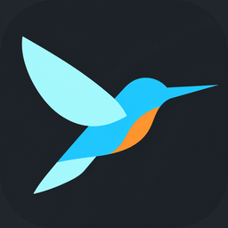

# flutter-runner

`fr` runs `flutter run` detached and keeps one machine-wide record of every instance in `~/.local/state/fr`. Any terminal, coding agent or git worktree can find, hot reload, restart and stop an app, whoever started it.

## Install

```sh
git clone https://github.com/RiccardoCherchi/flutter-runner ~/dev/flutter-runner
ln -sf ~/dev/flutter-runner/fr ~/.local/bin/fr

# Agent skill (Claude Code, and agents that read ~/.agents/skills)
mkdir -p ~/.claude/skills/flutter-runner ~/.agents/skills/flutter-runner
ln -sf ~/dev/flutter-runner/SKILL.md ~/.claude/skills/flutter-runner/SKILL.md
ln -sf ~/dev/flutter-runner/SKILL.md ~/.agents/skills/flutter-runner/SKILL.md
```

It needs bash, perl and the Flutter SDK. It has no other dependencies.

## Use

```sh
fr start                 # booted iOS simulator; streams the build, returns when the app is up
fr start -d macos -- --flavor dev
fr status                # 0  93D731F0-…  running  ~/app (main)  up 3m  pid 8552  ws://…
fr reload                # exit 1 with the compile error if the reload fails
fr restart 1             # by the number `fr status` shows, or a device id prefix
fr logs -f
fr stop
```

Without an instance argument, a command acts on the instance started from the current checkout, or on the only running one. One device runs one instance. A start from another checkout exits with code 3.

The VM Service URI of the checkout's instance is at `.dart_tool/fr.uri`. The symlink dangles once the app dies, so tools never read a stale URI.

Exit codes: 0 ok, 1 failure, 2 usage, 3 device busy.

## VS Code



The [Flutter Runner extension](vscode/README.md) connects VS Code's native Flutter workflow to persistent apps managed by `fr`. F5 attaches Dart-Code's debugger, with breakpoints, hot reload and hot restart. Ctrl+F5 runs without a debugger while keeping toolbar reload and restart. Disconnecting leaves the app running; **Flutter Runner: Stop Instance** terminates it explicitly.

See [extension setup and usage](vscode/README.md) for local VSIX installation.

Select the **Flutter Runner** launch configuration in **Run and Debug** before pressing F5 or Ctrl+F5. Installing the extension alone does not replace VS Code's automatic Dart/Flutter launch configuration.
