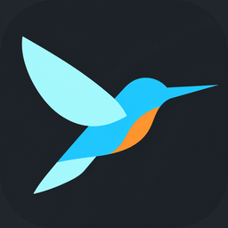

# Flutter Runner for VS Code



Use VS Code's native Flutter debug view with persistent apps managed by [`fr`](https://github.com/RiccardoCherchi/flutter-runner). F5 starts or reuses the current checkout's app, then attaches Dart-Code's debugger. Dart-Code provides breakpoints, variables, hot reload, hot restart and DevTools.

**Start Without Debugging** (Ctrl+F5) starts or reuses the same persistent app without attaching a VM debugger. The debug toolbar's lightning button runs `fr reload`; Restart runs `fr restart`. App logs appear in the Debug Console. Stopping this run session leaves the app running. The app still runs in Flutter's debug build mode so hot reload remains available.

Requires macOS or Linux, the `fr` CLI and Flutter on PATH, and the official Flutter extension (`Dart-Code.flutter`). Open the Flutter checkout root containing `pubspec.yaml` as a workspace folder. Workspace trust is required. The app must run in debug mode.

## Install and try

Install the local VSIX with **Extensions: Install from VSIX...**, then run **Flutter Runner: Start Debugging** from the command palette.

For F5 or Ctrl+F5, add this to `.vscode/launch.json` and select **Flutter Runner** in Run and Debug:

```json
{
  "version": "0.2.0",
  "configurations": [
    {
      "name": "Flutter Runner",
      "type": "flutter-runner",
      "request": "launch"
    }
  ]
}
```

With no existing instance, `fr` defaults to the booted iOS simulator. Set `"deviceId": "macos"` (or an exact device ID) to choose another target. Optional `"program": "lib/main_dev.dart"` and `"toolArgs": ["--flavor", "dev", "--dart-define=ENV=stage"]` apply when starting a new instance. These fields accept literal strings; launch variable expansion is not supported. Existing instances keep their original launch arguments. Multiple instances from the same checkout prompt for a device; instances from other checkouts are never reused automatically.

Disconnecting or stopping the debug session leaves the app running, including when VS Code closes. Use **Flutter Runner: Stop Instance** to terminate it; this command always asks which instance of this checkout to stop. CLI commands such as `fr reload`, `fr restart` and `fr stop` still work independently.

Build output and errors appear in the **Flutter Runner** output channel. Cancelling startup cancels the wait; a detached build or app may continue and can be inspected with `fr status` / `fr logs`.

If VS Code cannot find `fr`, set `"flutterRunner.executable": "/absolute/path/to/fr"` in settings. The VSIX does not bundle the CLI. Flutter must also be visible on VS Code's PATH. In debug sessions, hot reload on save follows Dart-Code's settings. In sessions without debugging, use the toolbar's lightning button to reload.

If either shortcut starts a regular Flutter launch, check that **Flutter Runner** is selected in the Run and Debug dropdown. Installing the extension alone does not replace VS Code's automatic Dart/Flutter configuration.

## Develop

```sh
cd vscode
npm test
npx @vscode/vsce package --allow-missing-repository --skip-license
code --extensionDevelopmentPath="$PWD" /path/to/flutter/project
```

No compilation or runtime npm dependencies are required. The extension-host smoke test (`test/extension-host.js`) expects a temporary Flutter workspace with a fake `fr` configured to return a running instance at `http://127.0.0.1:9/`, stream logs and accept reload/restart. It verifies Ctrl+F5, toolbar commands, and F5 forwarding into the native Flutter DAP adapter; it does not verify a live VM connection or a real app reload.
